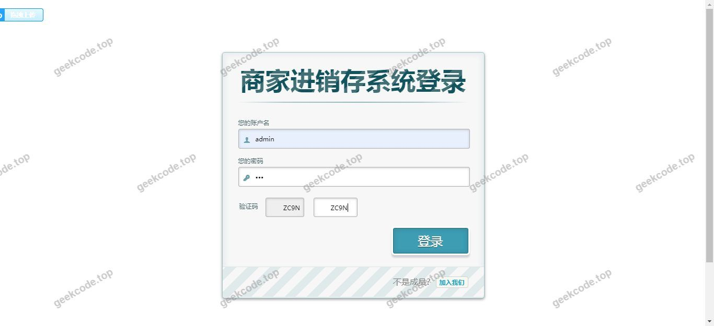
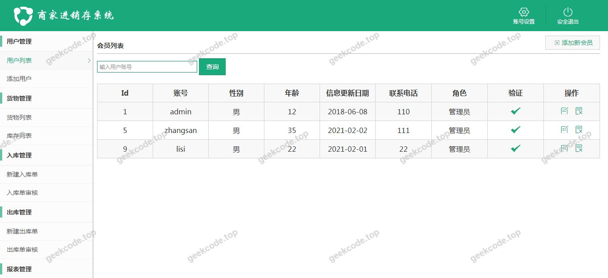
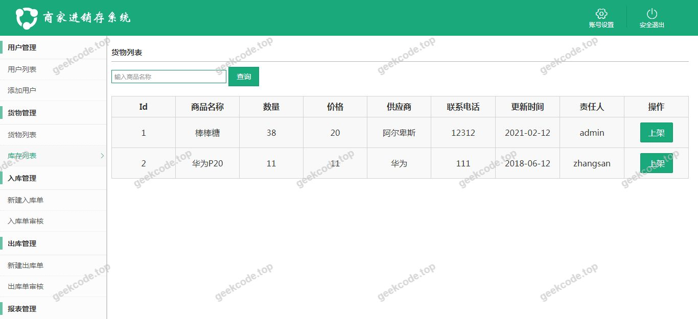
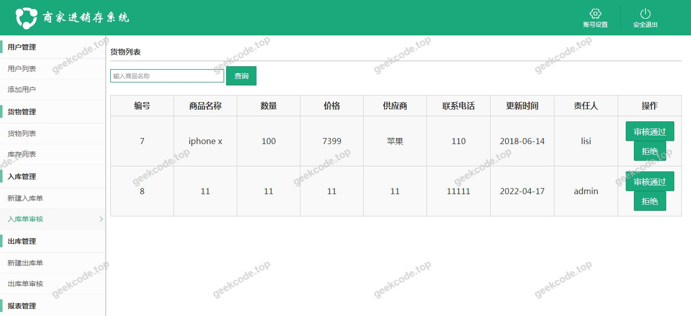
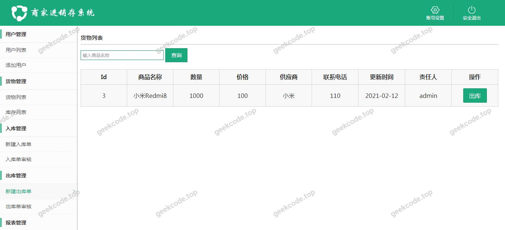
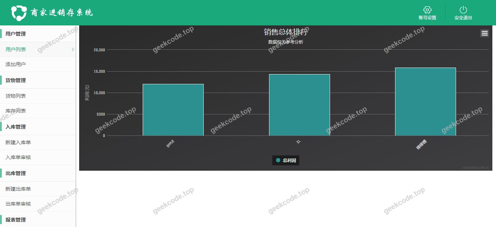

# java【毕业设计】精品项目-基于ssm的商家进销存系统

> 🎓 **计算机毕业设计 · java【毕业设计】精品项目-基于ssm的商家进销存系统**
>
> 本仓库只放**项目介绍 + 运行截图**（截图是站点带水印的原图，存在仓库 `images/` 里）。
>
> 👉 **完整可运行源码 / 数据库脚本 / 部署文档：[点我获取](https://geekcode.top/archives/java%E3%80%90%E6%AF%95%E4%B8%9A%E8%AE%BE%E8%AE%A1%E3%80%91%E7%B2%BE%E5%93%81%E9%A1%B9%E7%9B%AE-%E5%9F%BA%E4%BA%8Essm%E7%9A%84%E5%95%86%E5%AE%B6%E8%BF%9B%E9%94%80%E5%AD%98%E7%B3%BB%E7%BB%9F?utm_source=github)**
>
> 💬 咨询微信：**ir9372**　|　🌐 更多项目：[极客代码 geekcode.top](https://geekcode.top/?utm_source=github)
>
> 📌 项目详情页：<https://geekcode.top/archives/java%E3%80%90%E6%AF%95%E4%B8%9A%E8%AE%BE%E8%AE%A1%E3%80%91%E7%B2%BE%E5%93%81%E9%A1%B9%E7%9B%AE-%E5%9F%BA%E4%BA%8Essm%E7%9A%84%E5%95%86%E5%AE%B6%E8%BF%9B%E9%94%80%E5%AD%98%E7%B3%BB%E7%BB%9F?utm_source=github>

<table><td width="230" align="center"> <b>扫码加微信 ir9372</b></td><td valign="middle">📦 源码 = 项目介绍 + 全部运行截图 + 数据库 + 部署文档 👉 点上方任意截图，直接跳到 <b>极客代码 geekcode.top</b> 详情页</td></table>

---

<h1>java【毕业设计】精品项目-基于ssm的商家进销存系统</h1>
<h2>项目概述</h2>

本项目名为“基于SSM的商家进销存系统”，旨在为中小型商家提供一套轻量级、高效且易于维护的库存与供应链管理解决方案。随着商业活动日益频繁，传统的手工记账或简单的电子表格管理方式已难以满足对商品采购、销售、库存实时监控的需求，容易出现数据滞后、账实不符等问题。本系统基于Java语言开发，采用经典的SSM（Spring + Spring MVC + MyBatis）架构体系，结合JSP前端技术，实现了商家日常经营核心业务的数字化管理。

系统的核心功能聚焦于进销存业务流程，包括商品信息的录入与维护、采购入库管理、销售出库记录以及实时库存查询。适用人群主要为缺乏大型ERP系统预算但需要规范化管理库存数据的个体商户或小型零售企业。通过本系统，用户可以清晰地掌握资金流向与货物动态，提升运营效率，降低管理成本。

<h2>技术架构</h2>

本项目采用分层架构设计，严格遵循MVC设计模式，确保代码的高内聚低耦合，便于后期的扩展与维护。

<strong>1. 后端架构：SSM框架组合</strong>

<ul>
<li><strong>表现层 (Presentation Layer)</strong>：使用 <strong>Spring MVC</strong> 处理HTTP请求，负责接收前端参数并返回视图或数据响应。</li>
<li><strong>业务逻辑层 (Business Logic Layer)</strong>：由 <strong>Spring Framework</strong> 核心容器支撑，利用其IoC（控制反转）和AOP（面向切面编程）特性进行依赖注入和事务管理，确保业务处理的原子性和一致性。</li>
<li><strong>持久层 (Data Access Layer)</strong>：采用 <strong>MyBatis</strong> 作为ORM框架。相较于Hibernate，MyBatis提供了更灵活的SQL编写能力，适合复杂查询场景。配合 <code>mybatis-generator-core</code> 插件，可自动生成实体类、Mapper接口及XML映射文件，显著减少重复编码工作。</li>
</ul>

<strong>2. 数据库连接与管理</strong>

<ul>
<li><strong>数据库</strong>：使用 <strong>MySQL</strong> 存储所有业务数据，包括商品信息、用户账户、交易记录等。</li>
<li><strong>连接池</strong>：集成 <strong>c3p0</strong> 连接池技术，用于管理数据库连接的创建、复用和释放，有效提高系统在高并发下的响应速度和稳定性。</li>
<li><strong>驱动支持</strong>：引入 <code>mysql-connector-java</code> 以确保Java应用与MySQL数据库之间的通信畅通。</li>
</ul>

<strong>3. 前端技术</strong>

<ul>
<li>采用 <strong>JSP (JavaServer Pages)</strong> 技术构建用户界面。JSP能够与Servlet紧密协作，快速生成动态网页内容，适合此类后台管理系统的前端展示需求。</li>
</ul>

<strong>4. 测试与辅助工具</strong>

<ul>
<li>引入 <code>junit</code> 和 <code>spring-test</code> 进行单元测试和集成测试，保证代码质量。</li>
<li>使用 <code>spring-aspects</code> 增强AOP功能，可能用于日志记录或权限校验等非业务逻辑的代码解耦。</li>
</ul>
<h2>功能模块</h2>

根据提供的截图列表（系统运行界面1-6），虽然未明确标注具体菜单名称，但结合“商家进销存”的项目定位及SSM架构的典型实现，主要功能模块涵盖以下方面：

<strong>1. 基础信息管理模块</strong>

<ul>
<li><strong>商品档案管理</strong>：支持新增、修改、删除商品基本信息（如名称、编号、规格、单价、分类等）。这是进销存系统的数据基石。</li>
<li><strong>供应商/客户管理</strong>：维护上游供应商和下游客户的基本联系信息，便于在采购和销售单据中快速选择。</li>
</ul>

<strong>2. 进货管理模块</strong>

<ul>
<li><strong>采购订单录入</strong>：记录向供应商采购商品的详细信息，包括数量、价格、日期等。</li>
<li><strong>入库确认</strong>：当商品实际到达仓库时，执行入库操作，系统自动更新库存数量，并生成相应的入库流水记录。</li>
</ul>

<strong>3. 销售管理模块</strong>

<ul>
<li><strong>销售订单处理</strong>：录入客户的购买需求，生成销售单据。</li>
<li><strong>出库管理</strong>：确认发货后，系统扣减相应商品的库存，并记录销售金额，形成销售流水。</li>
</ul>

<strong>4. 库存管理模块</strong>

<ul>
<li><strong>实时库存查询</strong>：提供按商品名称、类别等多维度的库存状态查询，直观展示当前剩余数量。</li>
<li><strong>库存预警</strong>：(视具体实现而定) 可能包含低库存提醒功能，防止缺货影响销售。</li>
</ul>

<strong>5. 统计报表模块</strong>

<ul>
<li><strong>进销存汇总</strong>：展示一段时间内的总采购额、总销售额及毛利情况。</li>
<li><strong>明细查询</strong>：支持查看每一笔交易的具体细节，便于财务对账。</li>
</ul>

<em>(注：由于原始信息未提供具体的导航菜单文本，以上模块基于“进销存系统”的标准业务逻辑推导，具体界面布局请以实际运行截图为准。)</em>

<h2>用户角色与权限</h2>

鉴于项目描述中未明确区分多角色权限体系（如管理员与普通员工分离），且通常此类小型单机或局域网部署的SSM系统往往采用单一主账号管理模式，或者仅区分简单的登录与非登录状态。

<strong>1. 系统管理员 (Administrator)</strong>

<ul>
<li><strong>权限范围</strong>：拥有最高权限，可访问所有功能模块。</li>
<li><strong>具体功能</strong>：</li>
<li>全量数据的增删改查（商品、供应商、客户）。</li>
<li>执行所有的进货、销售、库存调整操作。</li>
<li>查看所有统计报表和历史记录。</li>
<li>若系统包含用户管理功能，则负责其他子账号的创建与权限分配（根据现有信息无法确定是否存在子账号功能，故默认以单管理员为主）。</li>
</ul>

<strong>2. 普通操作员 (Operator)</strong>

<ul>
<li><strong>状态说明</strong>：<strong>根据现有信息无法确定</strong>。</li>
<li>若系统设计为多用户协同，普通操作员可能仅具备录入单据（如开销售单、录采购单）和查询自己经手业务的权限，无权修改基础档案或删除历史记录。但在标准的简单版SSM进销存系统中，往往不强制划分此层级，所有登录用户均视为具有同等操作权限的管理员。</li>
</ul>
<h2>项目特色与创新点</h2>

<strong>1. 经典稳定的技术选型</strong>
采用成熟的SSM（Spring + Spring MVC + MyBatis）框架组合，而非较新的微服务架构。这种选择对于毕业设计而言，既展示了扎实的Java EE基础知识，又保证了系统的稳定性和易调试性。MyBatis的灵活性使得在处理复杂的进销存联表查询（如关联商品、订单、库存表）时更加高效可控。

<strong>2. 自动化代码生成提升开发效率</strong>
集成 <code>mybatis-generator-core</code>，实现了从数据库表结构到Java实体、Mapper接口及XML文件的自动化生成。这不仅减少了人工编写样板代码的错误率，也体现了开发者对工程化实践的理解，符合现代软件开发的敏捷理念。

<strong>3. 轻量级部署与维护</strong>
相比庞大的ERP系统，本系统专注于核心的“进、销、存”闭环，去除了冗余的生产制造、人力资源等模块。这使得系统资源占用少，启动速度快，非常适合硬件配置有限的中小商家环境，降低了IT运维门槛。

<strong>4. 数据一致性与事务管理</strong>
利用Spring的声明式事务管理，确保在涉及库存变动的关键业务节点（如入库、出库）中，数据更新的原子性。例如，在销售出库时，同时扣减库存和记录销售流水，若任一环节失败，整个事务回滚，避免了“账实不符”这一进销存管理中的致命问题。

<h2>部署环境</h2>

为了确保项目正常运行，需准备以下软硬件环境：

<strong>1. 操作系统</strong>

<ul>
<li>Windows 7/10/11 或 Linux (CentOS/Ubuntu)</li>
</ul>

<strong>2. Java开发环境</strong>

<ul>
<li><strong>JDK版本</strong>：建议 JDK 1.8 或以上（兼容Spring和MyBatis版本要求）。</li>
<li><strong>环境变量</strong>：需正确配置 <code>JAVA_HOME</code> 和 <code>PATH</code>。</li>
</ul>

<strong>3. Web服务器</strong>

<ul>
<li><strong>Tomcat</strong>：建议 Apache Tomcat 8.x 或 9.x 版本。由于项目类型为JSP，必须依赖Servlet容器来解析和运行JSP页面。</li>
</ul>

<strong>4. 数据库环境</strong>

<ul>
<li><strong>MySQL</strong>：建议 MySQL 5.7 或 8.0 版本。</li>
<li><strong>数据库客户端</strong>：Navicat for MySQL 或 MySQL Workbench，用于导入SQL脚本和管理数据。</li>
</ul>

<strong>5. 开发工具 (IDE)</strong>

<ul>
<li><strong>IntelliJ IDEA</strong> 或 <strong>Eclipse</strong> (配合STS插件)。</li>
<li><strong>Maven</strong>：虽然依赖列表中未显式提及pom.xml，但SSM项目通常使用Maven进行依赖管理（junit, spring-webmvc, mybatis等均为Maven坐标常见库）。若源码包含 <code>pom.xml</code>，则需安装 Maven 3.x；若无，则需手动将jar包放入 <code>WEB-INF/lib</code>。</li>
</ul>

<strong>6. 浏览器</strong>

<ul>
<li>Chrome、Firefox 或 Edge 等主流现代浏览器，用于访问JSP生成的Web界面。</li>
</ul>
<h2>五、技术特性</h2>
<ul>
<li>服务端模板渲染（JSP）</li>
</ul>
<h2>六、功能模块截图</h2>
<h3>前台用户端</h3>
<h4>系统运行界面1</h4>

<h4>系统运行界面2</h4>

<h4>系统运行界面3</h4>

<h4>系统运行界面4</h4>

<h4>系统运行界面5</h4>

<h4>系统运行界面6</h4>

---

## 获取完整源码

| 项目 | 说明 |
| --- | --- |
| 项目名 | java【毕业设计】精品项目-基于ssm的商家进销存系统 |
| 运行截图 | 本文 6 张（站点带水印原图，仓库 `images/` 目录） |
| 完整源码 | [https://geekcode.top/archives/java%E3%80%90%E6%AF%95%E4%B8%9A%E8%AE%BE%E8%AE%A1%E3%80%91%E7%B2%BE%E5%93%81%E9%A1%B9%E7%9B%AE-%E5%9F%BA%E4%BA%8Essm%E7%9A%84%E5%95%86%E5%AE%B6%E8%BF%9B%E9%94%80%E5%AD%98%E7%B3%BB%E7%BB%9F?utm_source=github](https://geekcode.top/archives/java%E3%80%90%E6%AF%95%E4%B8%9A%E8%AE%BE%E8%AE%A1%E3%80%91%E7%B2%BE%E5%93%81%E9%A1%B9%E7%9B%AE-%E5%9F%BA%E4%BA%8Essm%E7%9A%84%E5%95%86%E5%AE%B6%E8%BF%9B%E9%94%80%E5%AD%98%E7%B3%BB%E7%BB%9F?utm_source=github) |
| 咨询微信 | **ir9372**（备注：jingpin-yuanma） |
| 更多项目 | [极客代码 geekcode.top](https://geekcode.top/?utm_source=github) |

> 需要源码、部署、改配置、跑不起来等问题，加微信 ir9372 沟通，说明项目名即可。
